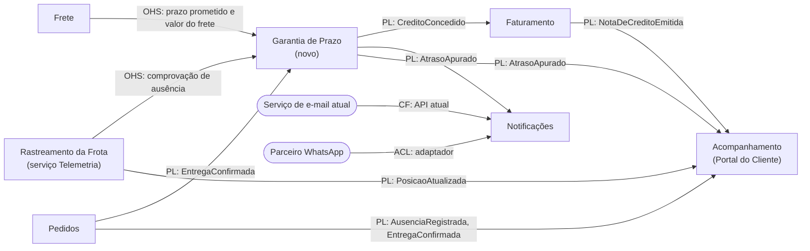

# 1. Modelagem do domínio

## Bounded contexts

A Garantia de Prazo é um contexto novo. Os contextos que já existem na plataforma participam
como fornecedores ou consumidores de fatos, sem absorver a regra do crédito. Cada requisito
funcional tem exatamente um contexto responsável.

| Contexto | Responsabilidade | Requisitos sob sua responsabilidade |
|---|---|---|
| **Garantia de Prazo** (novo) | Apurar o atraso de cada entrega, aplicar a política de crédito do tipo de cliente (faixa de atraso, multiplicador, teto e isenção por ausência comprovada) e garantir no máximo um crédito por pedido | RF01, RF02, RF03, RF04, RF09, RNF02 |
| **Rastreamento da Frota** (serviço Telemetria) | Receber as posições dos veículos, manter a posição atual e o trajeto, calcular a previsão de chegada e comprovar a ausência do destinatário | RF05 |
| **Faturamento** | Emitir a nota de crédito com número sequencial único e manter o saldo de créditos do cliente | RF06, RNF03 |
| **Notificações** | Avisar o cliente pelo canal preferido (e-mail pelo serviço atual ou WhatsApp pelo parceiro), com retentativas e fila de falhas | RF07, RF08 |
| **Acompanhamento** (Portal do Cliente) | Mostrar ao cliente a posição do veículo, a previsão de chegada e o saldo de créditos, com atualização ao vivo | RF10 |
| **Pedidos** | Cuidar do ciclo de vida do pedido: receber do app do motorista a confirmação de entrega e o registro de ausência e publicar esses fatos | Nenhum. Fornece os fatos `EntregaConfirmada` e `AusenciaRegistrada` |
| **Frete** | Calcular o frete: valor do frete e prazo prometido, que não mudam depois da contratação | Nenhum. Fornece o prazo prometido e o valor do frete |

Por que o RF05 fica no Rastreamento da Frota e não na Garantia de Prazo: a regra de comprovação
("veículo parado a até 200 m do endereço por pelo menos 10 min") é escrita na linguagem de
posição, distância e tempo parado. Se a Garantia calculasse distâncias, passaria a conhecer
coordenadas e trajetos. A Garantia só consome o resultado (ausência comprovada ou não) e aplica
a isenção.

Requisitos não funcionais transversais: o RNF01 (a telemetria tolera perda, a confirmação de
entrega não tolera) e o RNF04 (cada serviço em contêiner, tudo sobe com um comando) são decisões
de comunicação e de infraestrutura e estão resolvidos em
[`02-arquitetura.md`](02-arquitetura.md).

## Mapa de contexto

A seta sai do contexto **upstream** (quem fornece o modelo ou o dado) e chega ao
**downstream** (quem consome). Siglas: OHS = Open Host Service (API publicada pelo fornecedor);
PL = Published Language (evento com contrato publicado); ACL = Anti-Corruption Layer (camada que
traduz um modelo externo); CF = Conformist (o consumidor usa o modelo do fornecedor como ele é).

| Upstream | Downstream | Relação | O que trafega |
|---|---|---|---|
| Frete | Garantia de Prazo | OHS | Prazo prometido e valor do frete do pedido |
| Pedidos | Garantia de Prazo | PL | `EntregaConfirmada`: id da confirmação, pedido, cliente, tipo de cliente, horário da entrega e a ausência registrada antes da entrega, se houver (veículo, horário, coordenadas do endereço) |
| Rastreamento da Frota | Garantia de Prazo | OHS | Resultado da comprovação de ausência (comprovada ou não) |
| Garantia de Prazo | Faturamento | PL | `CreditoConcedido`: id do crédito, pedido, cliente e valor |
| Garantia de Prazo | Notificações | PL | `AtrasoApurado`: pedido, cliente, atraso e crédito (ou o motivo de não haver crédito) |
| Serviço de e-mail atual | Notificações | CF | Notificações usa a API atual de e-mail como ela é |
| Parceiro WhatsApp | Notificações | ACL | Um adaptador traduz a mensagem para o formato da API do parceiro |
| Rastreamento da Frota, Pedidos, Garantia de Prazo e Faturamento | Acompanhamento | PL | Posição e previsão de chegada, situação do pedido, crédito apurado, nota emitida e saldo |

## Entidades e agregados

| Agregado | Raiz | Entidades e objetos de valor | Regra que protege |
|---|---|---|---|
| Garantia do Pedido (Garantia de Prazo) | `GarantiaDoPedido`, identificada pelo id do pedido | Objetos de valor: `PrazoPrometido`, `ConfirmacaoDeEntrega` (id e horário), `Atraso` (minutos), `ValorDoFrete`, `TipoDeCliente`, `Credito` (valor ou motivo de não haver crédito), `SituacaoDaGarantia` | A garantia é apurada uma única vez por pedido: no máximo um crédito, mesmo com confirmação repetida (RF09). O crédito é o percentual da faixa vezes o multiplicador do tipo, limitado ao teto do tipo (RF02, RF03), e é zero quando a ausência é comprovada |
| Verificação de Ausência (Rastreamento da Frota) | `VerificacaoDeAusencia` | Objetos de valor: `AusenciaRegistrada` (veículo, horário, endereço), `Posicao` (latitude, longitude, velocidade, horário de medição), `ResultadoDaVerificacao` | Só é comprovada com o veículo parado a até 200 m do endereço desde pelo menos 10 min antes do registro; sem posições que cubram esse intervalo, não é comprovada (RF05) |
| Veículo (Rastreamento da Frota) | `Veiculo` | Entidade: `Trajeto`. Objetos de valor: `Posicao`, `PrevisaoDeChegada` | A posição atual é sempre a de medição mais recente: pacote atrasado ou fora de ordem não a substitui, e pacote perdido não invalida o trajeto (RNF01) |
| Nota de Crédito (Faturamento) | `NotaDeCredito` | Objetos de valor: `NumeroDaNota`, `ValorDoCredito`, id do crédito, id do cliente, data de emissão | Uma nota por crédito: o mesmo crédito recebido duas vezes não gera segunda nota (RF06) |
| Sequência de Notas (Faturamento) | `SequenciaDeNotasDeCredito` | Objeto de valor: `UltimoNumero` | Cada número é entregue uma única vez, em ordem e sem lacuna, mesmo com emissões concorrentes (RF06, RNF03) |
| Notificação (Notificações) | `Notificacao` | Entidade: `TentativaDeEnvio`. Objetos de valor: `Canal` (e-mail ou WhatsApp), `Destinatario`, `Mensagem`, `SituacaoDoEnvio` | No máximo o envio original e 3 retentativas; depois da última falha, a notificação fica como falha definitiva e vai para a fila de falhas, nunca é descartada (RF08) |
| Preferência de Contato (Notificações) | `PreferenciaDeContato`, identificada pelo cliente | Objetos de valor: `Canal`, e-mail, telefone | O canal preferido sempre tem o contato correspondente preenchido (RF07) |
| Pedido (Pedidos) | `Pedido` | Entidade: `TentativaDeEntrega`. Objetos de valor: `EnderecoDeEntrega` (com coordenadas), `ConfirmacaoDeEntrega`, `RegistroDeAusencia` | Um pedido tem no máximo uma confirmação de entrega; o reenvio da mesma confirmação devolve o mesmo resultado |
| Frete (Frete) | `Frete` | Objetos de valor: `PrazoPrometido`, `ValorDoFrete` | Prazo prometido e valor do frete não mudam depois da contratação, porque são a base de comparação da garantia |

Serviço de domínio sem estado: `CalculadoraDeCredito`, na Garantia de Prazo, escolhe a
`PoliticaDeCredito` do tipo de cliente (Varejo, Corporativo, Cortesia e tipos futuros) e calcula o
crédito. O Acompanhamento não tem agregados: mantém só uma projeção de leitura
(`AcompanhamentoDoPedido`) e não toma decisões de negócio.

## Linguagem ubíqua

| Termo | Definição |
|---|---|
| Garantia de Prazo | Compromisso da LogiTech de conceder crédito automático quando a entrega atrasa além da tolerância |
| Prazo prometido | Data e hora de entrega informadas pelo Frete na contratação; não mudam depois disso |
| Confirmação de entrega | Registro, feito pelo motorista no app, de que o pedido foi entregue. Tem identificador único e o horário da entrega |
| Atraso | Tempo entre o prazo prometido e a confirmação de entrega, contado em minutos inteiros e arredondado para cima (um minuto iniciado conta como minuto). Entrega no prazo ou antecipada tem atraso zero. As faixas são definidas em horas: 2 h = 120 min, 24 h = 1.440 min e 72 h = 4.320 min |
| Tolerância | Atraso de até 2 h, inclusive. Não gera crédito nem aviso de atraso |
| Faixa de atraso | Intervalo de atraso que define o percentual base: acima de 2 h até 24 h, 10%; acima de 24 h até 72 h, 25%; acima de 72 h, 50%. O limite superior de cada faixa pertence a ela |
| Multiplicador | Fator do tipo de cliente aplicado ao percentual base: 1 para Varejo e 2 para Corporativo |
| Teto | Valor máximo de crédito por pedido: R$ 500,00 para Varejo e R$ 2.000,00 para Corporativo |
| Crédito | Valor concedido ao cliente pelo atraso: valor do frete × percentual base × multiplicador, limitado ao teto e arredondado ao centavo (meio para cima) |
| Tipo de cliente | Classificação comercial que define a política de crédito: Varejo, Corporativo, Cortesia e os tipos que vierem depois |
| Política de crédito | Regra de cálculo do crédito de um tipo de cliente. Um tipo novo recebe uma política nova, sem alterar as que já existem |
| Cliente Cortesia | Cliente com frete zero. Nunca recebe crédito, mas é avisado quando o atraso passa da tolerância |
| Ausência registrada | Registro, pelo motorista, de que o destinatário não estava no endereço, com o horário do registro |
| Ausência comprovada | Ausência registrada em que a telemetria mostra o veículo parado (velocidade zero) a até 200 m do endereço desde pelo menos 10 min antes do registro. Pacotes perdidos no intervalo não invalidam a comprovação; sem posição que cubra o início do intervalo, a ausência não é comprovada |
| Isenção | Situação em que o atraso não gera crédito porque a ausência do destinatário foi comprovada |
| Apuração | Cálculo, feito uma única vez por pedido, do atraso e do crédito (ou do motivo de não haver crédito) |
| Confirmação duplicada | A mesma confirmação de entrega (mesmo identificador) recebida mais de uma vez; só a primeira tem efeito |
| Nota de crédito | Documento do Faturamento que formaliza um crédito. Existe uma nota para cada crédito |
| Número da nota | Número sequencial da nota de crédito, único e nunca reutilizado |
| Saldo de créditos | Soma dos créditos das notas emitidas para o cliente e ainda disponíveis para uso |
| Canal preferido | Canal escolhido pelo cliente para receber avisos: e-mail (serviço atual) ou WhatsApp (empresa parceira) |
| Retentativa | Novo envio de uma notificação que falhou; no máximo 3 por notificação |
| Falha definitiva | Situação da notificação que falhou no envio original e nas 3 retentativas. Vai para a fila de falhas e gera alerta |
| Posição | Latitude, longitude e velocidade de um veículo, com o horário da medição, recebidas a cada 30 s |
| Previsão de chegada | Horário estimado de chegada calculado a partir da posição atual. Não altera o prazo prometido |
